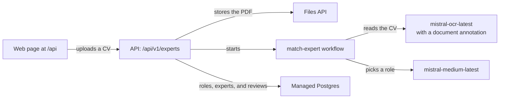

# Match experts to project roles from their CVs with Mistral Apps

Build a Mistral App that reads an expert's CV, picks the open project role that suits the expert best, and explains why, so a reviewer can approve or decline the match.

Staffing a project starts with reading CVs and comparing each one to the open roles. This cookbook builds a Mistral App that does the first pass. You upload a CV as a PDF in a small web page, and the `match-expert` workflow reads it with Mistral OCR. A document annotation turns the CV into a structured profile: name, headline, years of experience, skills, and a summary. `mistral-medium-latest` then compares the profile with the open roles and picks the best one, with a short reason. The page shows each match, and a reviewer approves or declines it.

You'll build the app from the `mistral apps init` scaffold, which gives you three modules:

| Path | What it is |
|---|---|
| `apps/api` | A FastAPI service at `/api`. You'll add the roles and experts API, and the web page. |
| `apps/worker` | The managed **Workflows** worker. You'll add the `match-expert` workflow. |
| `packages/py/db` | The managed Postgres database. You'll add the `role` and `expert` tables, their migration, and their accessors. |

The workflow uses two activities that ship with the Workflows plugin for Mistral, `mistralai_ocr` and `chat_parse_to_model`, so it needs no activities of its own.

Here's how a CV flows through the system:



The API checks on the workflow each time the page lists the experts. Once a run finishes, the API stores the profile and the match, and deletes the PDF from the Files API.

This cookbook walks you through creating every file. You can view [the complete project on GitHub](https://github.com/mistralai/cookbook/tree/main/mistral/agents/expert_matching_workflow/expert-matching-workflow).

## Prerequisites

To complete this cookbook, you will need:

- [uv](https://docs.astral.sh/uv/), which installs the Python version the project pins
- Docker, for the local Postgres database
- The `mistral` CLI with access to Mistral Apps
- git, and a GitHub account with the Mistral GitHub app installed on the repository you'll push to. Deploys build from that repository.
- A Mistral account with access to Studio and Workflows, and a Mistral API key from the workspace you'll deploy to
- A CV as a PDF to try the app with

## Environment setup

Scaffold the app, look at what you'll build, and add your API key.

### Install

Sign in to the Mistral CLI, then scaffold the app with the FastAPI, Postgres, Workflows, and Apps capabilities:

```bash
mistral login
mistral apps init expert-matching-workflow --caps fastapi,postgres,workflows,apps
cd expert-matching-workflow
```

`mistral apps init` creates the project folder, a git repository with a first commit, and a `.env` that holds the settings each capability needs. Unless a step says otherwise, run every command from this folder.

The scaffold already depends on the Mistral SDK and the Workflows plugin for Mistral, so the app needs no other packages. Install them:

```bash
uv sync --all-packages
```

### Create the project

By the end of the cookbook, you'll have added these files to the scaffold:

```text
expert-matching-workflow/
├── apps/
│   ├── api/src/api/routers/api/
│   │   ├── ui/
│   │   │   ├── __init__.py
│   │   │   ├── index.html
│   │   │   └── route.py
│   │   └── v1/
│   │       ├── __init__.py
│   │       ├── experts.py
│   │       └── roles.py
│   └── worker/src/worker/workflows/match_expert.py
└── packages/py/
    ├── db/src/db/
    │   ├── accessors/
    │   │   ├── expert.py
    │   │   └── role.py
    │   ├── migrations/versions/0001_expert_matching.py
    │   └── models/
    │       ├── expert.py
    │       └── role.py
    └── env/src/env/matching.py
```

You'll also edit a few scaffold files along the way.

### Required environment variables

To complete this cookbook, you'll need a Mistral API key. In [Studio](https://console.mistral.ai), navigate to the [API keys section](https://console.mistral.ai/home?profile_dialog=api-keys) and create a new API key. Create it in the workspace you'll deploy the app to. The app's gateway only accepts keys from that workspace.

`mistral apps init` already created a `.env` at the root of your project, and it's gitignored. Add your Mistral API key, and pick a deployment name for the worker you'll run on your machine:

```
MISTRAL_API_KEY=your-mistral-api-key
DEPLOYMENT_NAME=expert-matching-your-name
```

Both lines are already in `.env` with empty values, so fill them in rather than adding new lines.

## Step 1: Trim the scaffold

The scaffold includes JavaScript tooling (bun and Nx) and documentation for coding agents. This app is Python only, so remove them.

### 1.1 Remove the JavaScript tooling

Delete the Nx and bun files, the packages bun installed, the shell scripts that call them, and the `.agents/` folder:

```bash
rm -rf .agents node_modules .nxignore package.json bun.lock bunfig.toml nx.json \
  tools/install.sh tools/db.sh tools/lib.sh \
  apps/api/project.json apps/worker/project.json packages/py/db/project.json
```

Running `mistral apps capability add` later may bring some of these files back.

### 1.2 Update the files that referred to them

Five scaffold files still refer to the tooling you removed. In `.dockerignore`, delete these two lines:

```text
**/.nx
.nx
```

In `.gitignore`, delete the `.nx` line under `# Nx`.

The `migrations` command prints a hint that names an Nx target. In `packages/py/cli/src/cli/commands/migrations.py`, change the `hint` in the `no_migrations_present` log call to:

```python
            hint="no selected capability owns a table; add a model and an Alembic revision for it",
```

The settings package finds the project root by looking for `package.json`, which no longer exists. In `packages/py/env/src/env/_base.py`, make `_find_repo_root` look for `apps.json` instead:

```python
def _find_repo_root() -> Path:
    for parent in Path(__file__).resolve().parents:
        if (parent / "apps.json").is_file() and (parent / "pyproject.toml").is_file():
            return parent
    return Path.cwd()
```

Without this change, the settings miss your `.env` when a command runs from a subfolder.

In `tools/uv.sh`, replace the three comment lines that start with `# Executed directly (an NX` with one line:

```bash
# Executed directly -> run uv with this environment. Sourced -> only export the environment.
```

## Step 2: Add the settings

The workflow reads the two model names from settings, so you can try other models without changing code.

Create the settings module:

**`packages/py/env/src/env/matching.py`**

```python
"""Settings for expert matching: the models that read a CV and pick a role."""

from env._base import BaseEnv


class Env(BaseEnv):
    ocr_model: str = "mistral-ocr-latest"
    matching_model: str = "mistral-medium-latest"


env = Env()
```

`OCR_MODEL` defaults to `mistral-ocr-latest` and `MATCHING_MODEL` to `mistral-medium-latest`. To try other models, add them to `.env`:

```
OCR_MODEL=mistral-ocr-latest
MATCHING_MODEL=mistral-medium-latest
```

## Step 3: Add the role and expert tables

The app stores the open roles and the uploaded experts in its managed Postgres database. The scaffold discovers every model in `db/models/` and applies every migration in `db/migrations/versions/`, so adding a table means adding files, not editing a list.

### 3.1 Add the models

Create the model for the `role` table, the open roles experts are matched against:

**`packages/py/db/src/db/models/role.py`**

```python
"""A project role an expert can be matched to."""

from sqlmodel import Field, SQLModel


class Role(SQLModel, table=True):
    __tablename__ = "role"

    id: int | None = Field(default=None, primary_key=True)
    title: str
    project: str
    description: str
```

Create the model for the `expert` table. Each row starts as an uploaded file with a workflow run. Once the run finishes, it holds the profile read from the CV, the matched role, and the reason. `review` records the reviewer's decision:

**`packages/py/db/src/db/models/expert.py`**

```python
"""An uploaded CV, the profile read from it, and the role it was matched to."""

from datetime import UTC, datetime

from sqlalchemy import JSON, Column
from sqlmodel import Field, SQLModel


def _now() -> datetime:
    return datetime.now(UTC)


class Expert(SQLModel, table=True):
    __tablename__ = "expert"

    id: int | None = Field(default=None, primary_key=True)
    file_name: str
    file_id: str
    execution_id: str | None = None
    # processing, then matched or failed
    status: str = "processing"
    name: str | None = None
    headline: str | None = None
    years_of_experience: int | None = None
    skills: list[str] = Field(default_factory=list, sa_column=Column(JSON, nullable=False))
    summary: str | None = None
    role_id: int | None = None
    reason: str | None = None
    # pending, approved or declined
    review: str = "pending"
    created_at: datetime = Field(default_factory=_now)
```

### 3.2 Add the migration

Create the migration that creates both tables and adds three sample roles, so you can try the app right away. The `branch_labels` entry keeps it on its own branch, as the scaffold expects from every table owner:

**`packages/py/db/src/db/migrations/versions/0001_expert_matching.py`**

```python
"""Create the role and expert tables, and add three sample roles.

Revision ID: 0001
Revises:
Create Date: 2026-11-05

"""

from collections.abc import Sequence

import sqlalchemy as sa
from alembic import op

revision: str = "0001"
down_revision: str | Sequence[str] | None = None
branch_labels: str | Sequence[str] | None = ("expert_matching",)
depends_on: str | Sequence[str] | None = None


def upgrade() -> None:
    role = op.create_table(
        "role",
        sa.Column("id", sa.Integer(), primary_key=True),
        sa.Column("title", sa.String(), nullable=False),
        sa.Column("project", sa.String(), nullable=False),
        sa.Column("description", sa.String(), nullable=False),
    )
    op.create_table(
        "expert",
        sa.Column("id", sa.Integer(), primary_key=True),
        sa.Column("file_name", sa.String(), nullable=False),
        sa.Column("file_id", sa.String(), nullable=False),
        sa.Column("execution_id", sa.String(), nullable=True),
        sa.Column("status", sa.String(), nullable=False),
        sa.Column("name", sa.String(), nullable=True),
        sa.Column("headline", sa.String(), nullable=True),
        sa.Column("years_of_experience", sa.Integer(), nullable=True),
        sa.Column("skills", sa.JSON(), nullable=False),
        sa.Column("summary", sa.String(), nullable=True),
        sa.Column("role_id", sa.Integer(), nullable=True),
        sa.Column("reason", sa.String(), nullable=True),
        sa.Column("review", sa.String(), nullable=False),
        sa.Column("created_at", sa.DateTime(timezone=True), nullable=False),
    )
    op.bulk_insert(
        role,
        [
            {
                "title": "Data platform engineer",
                "project": "Retail demand forecasting",
                "description": (
                    "Build the ingestion pipelines and feature store behind a weekly demand forecast. "
                    "Python, SQL, Spark or similar, and experience running pipelines in production."
                ),
            },
            {
                "title": "Cloud security architect",
                "project": "Bank cloud migration",
                "description": (
                    "Design identity, network and key management for a bank moving workloads to the cloud. "
                    "Experience with regulated environments and security reviews."
                ),
            },
            {
                "title": "Product designer",
                "project": "Patient booking app",
                "description": (
                    "Lead user research and design the booking flow of a mobile app for clinics. "
                    "Strong portfolio in mobile UX and accessibility."
                ),
            },
        ],
    )


def downgrade() -> None:
    op.drop_table("expert")
    op.drop_table("role")
```

`mistral apps dev` applies it locally, and the deployed API applies it before it starts.

### 3.3 Add the accessors

Create the functions the API uses to read and write the `role` table:

**`packages/py/db/src/db/accessors/role.py`**

```python
"""Reads and writes of the ``role`` table."""

from sqlmodel import col, select

from db.engine import get_session_maker
from db.models.role import Role


async def create_role(role: Role) -> Role:
    async with get_session_maker()() as session:
        session.add(role)
        await session.commit()
        await session.refresh(role)
    return role


async def list_roles() -> list[Role]:
    async with get_session_maker()() as session:
        rows = await session.execute(select(Role).order_by(col(Role.id)))
        return list(rows.scalars())
```

Create the ones for the `expert` table. `save_expert` merges the row, so it both inserts a new expert and stores the changes to one the API read earlier:

**`packages/py/db/src/db/accessors/expert.py`**

```python
"""Reads and writes of the ``expert`` table."""

from sqlmodel import col, select

from db.engine import get_session_maker
from db.models.expert import Expert


async def save_expert(expert: Expert) -> Expert:
    """Insert a new expert, or write the changes to one read earlier."""
    async with get_session_maker()() as session:
        expert = await session.merge(expert)
        await session.commit()
        await session.refresh(expert)
    return expert


async def get_expert(expert_id: int) -> Expert | None:
    async with get_session_maker()() as session:
        return await session.get(Expert, expert_id)


async def list_experts(limit: int = 50) -> list[Expert]:
    async with get_session_maker()() as session:
        rows = await session.execute(select(Expert).order_by(col(Expert.id).desc()).limit(limit))
        return list(rows.scalars())
```

## Step 4: Add the workflow

The worker discovers every workflow class in `worker/workflows/`. The `match-expert` workflow takes the ID of an uploaded CV and the open roles, and runs two steps:

1. `mistralai_ocr` reads the CV. Its `document_annotation_format` is the JSON schema of `ExpertProfile`, so the OCR response includes the profile as JSON in `document_annotation`. The field descriptions tell the model what to extract.
2. `chat_parse_to_model` sends the profile and the roles to the matching model and parses its answer into a `RoleMatch`.

Both are activities from the Workflows plugin for Mistral. If the worker restarts after the OCR step, the run resumes without reading the CV again.

**`apps/worker/src/worker/workflows/match_expert.py`**

```python
import json

from mistralai import workflows
from mistralai.workflows import workflow
from pydantic import BaseModel, Field

with workflow.unsafe.imports_passed_through():
    from env.matching import env
    from mistralai.client.models import (
        ChatCompletionRequest,
        FileChunk,
        OCRRequest,
        ResponseFormat,
        SystemMessage,
        UserMessage,
    )
    from mistralai.extra import response_format_from_pydantic_model
    from mistralai.workflows.plugins.mistralai import chat_parse_to_model, mistralai_ocr

PROMPT = """You staff experts on client projects. Given an expert's profile and a list of open roles,
pick the one role the expert fits best. Explain why in two or three sentences, naming the skills
or experience that match, and anything the expert lacks for the role."""


class RoleBrief(BaseModel):
    id: int
    title: str
    project: str
    description: str


class MatchRequest(BaseModel):
    file_id: str
    roles: list[RoleBrief]


class ExpertProfile(BaseModel):
    name: str = Field(description="The expert's full name")
    headline: str = Field(description="Current or most recent job title, with the employer")
    years_of_experience: int = Field(description="Total years of professional experience")
    skills: list[str] = Field(description="Up to ten key skills, tools or domains")
    summary: str = Field(description="Two sentences on what the expert has done")


class RoleMatch(BaseModel):
    role_id: int
    reason: str


class MatchResult(BaseModel):
    profile: ExpertProfile
    match: RoleMatch


@workflows.workflow.define(
    name="match-expert",
    workflow_display_name="Match expert",
    workflow_description="Read an expert's CV and pick the project role that suits the expert best.",
)
class MatchExpert:
    @workflows.workflow.entrypoint
    async def run(self, request: MatchRequest) -> MatchResult:
        ocr = await mistralai_ocr(
            OCRRequest(
                model=env.ocr_model,
                document=FileChunk(file_id=request.file_id),
                document_annotation_format=ResponseFormat.model_validate(
                    response_format_from_pydantic_model(ExpertProfile)
                ),
            )
        )
        profile = ExpertProfile.model_validate_json(ocr.document_annotation)

        roles = json.dumps([role.model_dump() for role in request.roles], indent=2)
        match = await chat_parse_to_model(
            RoleMatch,
            ChatCompletionRequest(
                model=env.matching_model,
                messages=[
                    SystemMessage(content=PROMPT),
                    UserMessage(content=f"Expert profile:\n{profile.model_dump_json(indent=2)}\n\nRoles:\n{roles}"),
                ],
            ),
        )
        return MatchResult(profile=profile, match=match)
```

The worker reaches the Mistral API with your `MISTRAL_API_KEY` on your machine. Once deployed, it uses the token the platform mounts for it, so it needs no secrets.

## Step 5: Add the API

The API stores the roles, uploads CVs, starts the workflow, and records reviews. The scaffold mounts every router module under `routers/` at its folder path, so the files below serve `/api/v1/roles` and `/api/v1/experts`.

### 5.1 Require the Apps gateway

A deployed app sits behind the Apps gateway, which signs each caller in and forwards a token. The `dependencies` in a router package's `__init__.py` apply to every route in it, so this check rejects any `/api/v1` request that didn't come through the gateway:

**`apps/api/src/api/routers/api/v1/__init__.py`**

```python
"""The matching API. Every route needs a caller signed in through the Apps gateway."""

from fastapi import HTTPException, Request, params, status
from mistralai_capabilities.apps.tokens import token_from


def require_caller(request: Request) -> None:
    # The gateway signs the caller in and forwards a token; a request without one bypassed it.
    if not token_from(request.headers):
        raise HTTPException(status.HTTP_401_UNAUTHORIZED, "Call this API through the app's gateway")


dependencies: tuple[params.Depends, ...] = (params.Depends(require_caller),)
```

### 5.2 Add the roles routes

Create the routes that list and add open roles:

**`apps/api/src/api/routers/api/v1/roles.py`**

```python
from db.accessors.role import create_role, list_roles
from db.models.role import Role
from fastapi import APIRouter, status
from pydantic import BaseModel

router = APIRouter(tags=["roles"])


class NewRole(BaseModel):
    title: str
    project: str
    description: str


class RoleOut(NewRole):
    id: int


@router.get("")
async def list_all() -> list[RoleOut]:
    """List the open roles experts are matched against."""
    return [RoleOut.model_validate(r, from_attributes=True) for r in await list_roles()]


@router.post("", status_code=status.HTTP_201_CREATED)
async def create(body: NewRole) -> RoleOut:
    """Add an open role."""
    role = await create_role(Role(**body.model_dump()))
    return RoleOut.model_validate(role, from_attributes=True)
```

### 5.3 Add the experts routes

Create the routes that upload a CV, list the experts, and record a review:

- `POST /api/v1/experts` uploads the PDF to the Files API with the `ocr` purpose, starts `match-expert` without waiting for it, and stores the expert with the run's execution ID.
- `GET /api/v1/experts` lists the experts. For each one still processing, `_refresh` reads the run. When the run has finished, it stores the result, or marks the expert as failed, and deletes the PDF from the Files API.
- `POST /api/v1/experts/{expert_id}/review` approves or declines a match.

**`apps/api/src/api/routers/api/v1/experts.py`**

```python
from datetime import datetime
from typing import Literal

from db.accessors.expert import get_expert, list_experts, save_expert
from db.accessors.role import list_roles
from db.models.expert import Expert
from fastapi import APIRouter, HTTPException, UploadFile, status
from mistralai_capabilities.workflows.client import get_client, start_workflow
from pydantic import BaseModel
from utils.mistral import mistral_client
from worker.workflows.match_expert import (
    MatchExpert,
    MatchRequest,
    MatchResult,
    RoleBrief,
)

router = APIRouter(tags=["experts"])

FAILED = {"FAILED", "CANCELED", "TERMINATED", "TIMED_OUT"}


class ExpertOut(BaseModel):
    id: int
    file_name: str
    status: str
    name: str | None
    headline: str | None
    years_of_experience: int | None
    skills: list[str]
    summary: str | None
    role_id: int | None
    reason: str | None
    review: str
    created_at: datetime


class Review(BaseModel):
    review: Literal["approved", "declined"]


async def _refresh(expert: Expert) -> Expert:
    """Store the workflow's result once it has finished."""
    client = await get_client()
    execution = await client.workflows.executions.get_workflow_execution_async(execution_id=expert.execution_id)
    if execution.status == "COMPLETED":
        result = MatchResult.model_validate(execution.result)
        expert.sqlmodel_update(result.profile.model_dump())
        expert.role_id = result.match.role_id
        expert.reason = result.match.reason
        expert.status = "matched"
    elif execution.status in FAILED:
        expert.status = "failed"
    else:
        return expert
    await mistral_client().files.delete_async(file_id=expert.file_id)
    return await save_expert(expert)


@router.post("", status_code=status.HTTP_202_ACCEPTED)
async def upload(file: UploadFile) -> ExpertOut:
    """Upload an expert's CV as a PDF and start matching it to a role."""
    roles = await list_roles()
    if not roles:
        raise HTTPException(status.HTTP_409_CONFLICT, "Add a role first")
    uploaded = await mistral_client().files.upload_async(
        file={"file_name": file.filename or "cv.pdf", "content": await file.read()},
        purpose="ocr",
    )
    run = await start_workflow(
        MatchExpert,
        MatchRequest(
            file_id=uploaded.id,
            roles=[RoleBrief.model_validate(r, from_attributes=True) for r in roles],
        ),
        wait_for_result=False,
    )
    expert = await save_expert(
        Expert(
            file_name=uploaded.filename,
            file_id=uploaded.id,
            execution_id=run.execution_id,
        )
    )
    return ExpertOut.model_validate(expert, from_attributes=True)


@router.get("")
async def list_all(limit: int = 50) -> list[ExpertOut]:
    """List the uploaded experts, newest first, with the role each was matched to."""
    experts = [await _refresh(e) if e.status == "processing" else e for e in await list_experts(limit)]
    return [ExpertOut.model_validate(e, from_attributes=True) for e in experts]


@router.post("/{expert_id}/review")
async def review(expert_id: int, body: Review) -> ExpertOut:
    """Approve or decline the role an expert was matched to."""
    expert = await get_expert(expert_id)
    if expert is None:
        raise HTTPException(status.HTTP_404_NOT_FOUND, "No such expert")
    if expert.status != "matched":
        raise HTTPException(status.HTTP_409_CONFLICT, "This expert has no match to review yet")
    expert.review = body.review
    return ExpertOut.model_validate(await save_expert(expert), from_attributes=True)
```

`start_workflow` starts the run on the deployment named in `DEPLOYMENT_NAME`, which is your local worker when you run the app on your machine.

## Step 6: Add the web page

The page is one HTML file with a little JavaScript. It calls the API from the browser, so it needs no build step.

### 6.1 Serve the page at /api

The page holds no data, so its router package needs no caller. Every request it makes to `/api/v1` still goes through the check from Step 5.1. Setting `segment` to an empty string mounts the package at its parent's path, so the page is at `/api`:

**`apps/api/src/api/routers/api/ui/__init__.py`**

```python
"""The web page. It holds no data, so it is served without a caller; the API calls it makes are not."""

from fastapi import params

# Serve the page at the API prefix itself: ``route.py`` is ``/api``.
segment = ""
dependencies: tuple[params.Depends, ...] = ()
```

Create the route that returns the page. A `route.py` module serves its folder's own path:

**`apps/api/src/api/routers/api/ui/route.py`**

```python
from pathlib import Path

from fastapi import APIRouter
from fastapi.responses import HTMLResponse

router = APIRouter(include_in_schema=False)

PAGE = (Path(__file__).parent / "index.html").read_text(encoding="utf-8")


@router.get("", response_class=HTMLResponse)
async def page() -> str:
    return PAGE
```

### 6.2 Add the page

The page has an upload form, a table of experts with their best role and the review buttons, and the list of open roles with a form to add one. While any CV is still being read, it reloads the experts every three seconds:

**`apps/api/src/api/routers/api/ui/index.html`**

```html
<!doctype html>
<html lang="en">
<head>
  <meta charset="utf-8">
  <meta name="viewport" content="width=device-width, initial-scale=1">
  <title>Expert matching</title>
  <style>
    body { font-family: system-ui, sans-serif; max-width: 960px; margin: 2rem auto; padding: 0 1rem; color: #1a1a1a; }
    h2 { margin-top: 2rem; }
    form { display: flex; gap: .5rem; flex-wrap: wrap; align-items: center; }
    input, textarea, button { font: inherit; padding: .4rem .6rem; }
    textarea { width: 100%; }
    table { width: 100%; border-collapse: collapse; }
    th, td { text-align: left; vertical-align: top; padding: .5rem; border-bottom: 1px solid #ddd; }
    .muted { color: #666; font-size: .9em; }
    .error { color: #b00020; }
  </style>
</head>
<body>
  <h1>Expert matching</h1>
  <p>Upload an expert's CV. The agent reads it and picks the open role that suits the expert best.</p>

  <form id="upload">
    <input type="file" name="file" accept="application/pdf" required>
    <button>Upload CV</button>
    <span id="upload-status" class="muted"></span>
  </form>

  <h2>Experts</h2>
  <table>
    <thead><tr><th>Expert</th><th>Best role</th><th>Review</th></tr></thead>
    <tbody id="experts"></tbody>
  </table>

  <h2>Open roles</h2>
  <ul id="roles"></ul>
  <form id="new-role">
    <input name="title" placeholder="Role title" required>
    <input name="project" placeholder="Project" required>
    <textarea name="description" rows="2" placeholder="What the role needs" required></textarea>
    <button>Add role</button>
  </form>

  <script>
    const api = (path, options) =>
      fetch(`/api/v1/${path}`, options).then(async (response) => {
        if (!response.ok) throw new Error((await response.json()).detail ?? response.statusText);
        return response.json();
      });
    const escape = (text) => String(text ?? "").replace(/[&<>"]/g, (c) => `&#${c.charCodeAt(0)};`);
    let roles = [];

    async function loadRoles() {
      roles = await api("roles");
      document.getElementById("roles").innerHTML = roles
        .map((r) => `<li><strong>${escape(r.title)}</strong>, ${escape(r.project)}<br><span class="muted">${escape(r.description)}</span></li>`)
        .join("");
    }

    function describe(expert) {
      if (expert.status === "processing") return `<td>${escape(expert.file_name)}<br><span class="muted">Reading the CV…</span></td><td></td><td></td>`;
      if (expert.status === "failed") return `<td>${escape(expert.file_name)}<br><span class="error">Matching failed</span></td><td></td><td></td>`;
      const role = roles.find((r) => r.id === expert.role_id);
      const review = expert.review === "pending"
        ? `<button onclick="review(${expert.id}, 'approved')">Approve</button> <button onclick="review(${expert.id}, 'declined')">Decline</button>`
        : escape(expert.review);
      return `<td><strong>${escape(expert.name)}</strong>, ${escape(expert.headline)}<br>
          <span class="muted">${escape(expert.years_of_experience)} years · ${expert.skills.map(escape).join(", ")}</span></td>
        <td><strong>${escape(role?.title ?? `Role ${expert.role_id}`)}</strong><br><span class="muted">${escape(expert.reason)}</span></td>
        <td>${review}</td>`;
    }

    async function loadExperts() {
      const experts = await api("experts");
      document.getElementById("experts").innerHTML = experts.map((e) => `<tr>${describe(e)}</tr>`).join("");
      if (experts.some((e) => e.status === "processing")) setTimeout(loadExperts, 3000);
    }

    async function review(id, decision) {
      await api(`experts/${id}/review`, {
        method: "POST",
        headers: { "Content-Type": "application/json" },
        body: JSON.stringify({ review: decision }),
      });
      await loadExperts();
    }

    document.getElementById("upload").addEventListener("submit", async (event) => {
      event.preventDefault();
      const status = document.getElementById("upload-status");
      status.textContent = "Uploading…";
      try {
        await api("experts", { method: "POST", body: new FormData(event.target) });
        status.textContent = "";
        event.target.reset();
        await loadExperts();
      } catch (error) {
        status.textContent = error.message;
      }
    });

    document.getElementById("new-role").addEventListener("submit", async (event) => {
      event.preventDefault();
      await api("roles", {
        method: "POST",
        headers: { "Content-Type": "application/json" },
        body: JSON.stringify(Object.fromEntries(new FormData(event.target))),
      });
      event.target.reset();
      await loadRoles();
    });

    loadRoles().then(loadExperts);
  </script>
</body>
</html>
```

Format the project with Ruff, at the scaffold's line length, so the new files match its code style:

```bash
uvx ruff format --line-length 120 apps packages
```

## Step 7: Try it on your machine

Start the API, the worker, and a local Postgres database:

```bash
mistral apps dev
```

The command applies the migration, which adds the three sample roles, and serves the app through a local gateway at `http://expert-matching-workflow.apps.localhost:8080`. Your local worker registers on the deployment you named in `DEPLOYMENT_NAME`.

The gateway lets a request through when it carries a Mistral API key from the app's workspace in an `X-Api-Key` header. In a second terminal, run `source .env` if `MISTRAL_API_KEY` isn't set in your shell, then list the roles:

```bash
curl -H "X-Api-Key: $MISTRAL_API_KEY" http://expert-matching-workflow.apps.localhost:8080/api/v1/roles
```

```json
[
  {
    "title": "Data platform engineer",
    "project": "Retail demand forecasting",
    "description": "Build the ingestion pipelines and feature store behind a weekly demand forecast. Python, SQL, Spark or similar, and experience running pipelines in production.",
    "id": 1
  },
  {
    "title": "Cloud security architect",
    "project": "Bank cloud migration",
    "description": "Design identity, network and key management for a bank moving workloads to the cloud. Experience with regulated environments and security reviews.",
    "id": 2
  },
  {
    "title": "Product designer",
    "project": "Patient booking app",
    "description": "Lead user research and design the booking flow of a mobile app for clinics. Strong portfolio in mobile UX and accessibility.",
    "id": 3
  }
]
```

Upload a CV. Replace `cv.pdf` with the path to yours:

```bash
curl -H "X-Api-Key: $MISTRAL_API_KEY" -F "file=@cv.pdf" http://expert-matching-workflow.apps.localhost:8080/api/v1/experts
```

```json
{
  "id": 1,
  "file_name": "cv.pdf",
  "status": "processing",
  "name": null,
  "headline": null,
  "years_of_experience": null,
  "skills": [],
  "summary": null,
  "role_id": null,
  "reason": null,
  "review": "pending",
  "created_at": "2026-11-05T15:20:51.774192Z"
}
```

After a few seconds, list the experts:

```bash
curl -H "X-Api-Key: $MISTRAL_API_KEY" http://expert-matching-workflow.apps.localhost:8080/api/v1/experts
```

The workflow has read the CV and picked a role. For a CV of a senior data engineer, the result looks like this:

```json
[
  {
    "id": 1,
    "file_name": "cv.pdf",
    "status": "matched",
    "name": "Ana Duarte",
    "headline": "Senior data engineer at Northwind Logistics",
    "years_of_experience": 9,
    "skills": ["Python", "SQL", "Apache Spark", "Kafka", "Airflow", "dbt", "BigQuery", "Terraform", "Docker", "data modelling"],
    "summary": "Senior data engineer with 9 years of experience building scalable data pipelines and infrastructure. Expert in optimizing batch and streaming workflows to deliver faster insights and operational efficiency.",
    "role_id": 1,
    "reason": "Ana Duarte's 9 years of experience as a senior data engineer, along with her expertise in Python, SQL, Apache Spark, Kafka, and Airflow, align perfectly with the Data Platform Engineer role's requirements for building ingestion pipelines and feature stores. While she lacks explicit experience in retail demand forecasting, her production pipeline experience and toolset make her the best fit.",
    "review": "pending",
    "created_at": "2026-11-05T15:20:51.774192Z"
  }
]
```

Approve the match:

```bash
curl -H "X-Api-Key: $MISTRAL_API_KEY" -H "Content-Type: application/json" -d '{"review": "approved"}' \
  http://expert-matching-workflow.apps.localhost:8080/api/v1/experts/1/review
```

The response is the expert with `"review": "approved"`. Each run also appears in **Studio > Workflows > match-expert**, with its input, the OCR result, and the model's answer.

To use the page, open `http://expert-matching-workflow.apps.localhost:8080/api` in your browser and sign in with your Mistral account. Upload a CV, wait for the match, and approve or decline it.

Stop `mistral apps dev` when you're done.

## Step 8: Push the project to GitHub

Deploys build from the pushed commit, not from your local files. Create an empty GitHub repository (for example `expert-matching-workflow`), install the Mistral GitHub app on it, then push:

```bash
git remote add origin https://github.com/<your-username>/expert-matching-workflow.git
git add -A
git commit -m "Add the expert matching workflow"
git push -u origin main
```

`.env` is gitignored, so your settings stay on your machine.

## Step 9: Deploy the app

Deploy the app to Mistral Apps:

```bash
mistral apps deploy
```

The command asks which organization and workspace to deploy to. Pick the workspace your API key belongs to. It builds the API and the worker from the commit you pushed, sets up the managed Postgres database, and prints the app's URL. The API applies the migration before it starts, so the deployed app has the three sample roles too. The command also adds a `deployment` block to `apps.json` that records the target. Commit and push it, so the next deploy goes to the same app:

```bash
git add apps.json
git commit -m "Save the Mistral Apps deployment target"
git push
```

## Step 10: Try the deployed app

Open `https://<app-url>/api` in your browser, where `<app-url>` is the URL the deploy printed, and sign in with your Mistral account. Add your own open roles at the bottom of the page, then upload a CV. The match appears in the table once the deployed workflow has read the CV.

The API answers the same requests as on your machine. Replace `<app-url>` with your app's URL:

```bash
curl -H "X-Api-Key: $MISTRAL_API_KEY" https://<app-url>/api/v1/experts
```

## Updating, operating and cleaning up

Use these steps to ship changes and remove everything you created.

**Shipping a change**

Commit and push, then run `mistral apps deploy` again. To change a table, add a migration in `db/migrations/versions/` whose `down_revision` is the latest one, such as `"0001"`. The deployed API applies it before it starts.

**Rules of thumb**

- Never log CV text, profiles, or API keys. CVs hold personal data.
- Keep model names in settings. They come only from `OCR_MODEL` and `MATCHING_MODEL`.
- Treat a match as a suggestion. The review step is where a person decides.

**Cleaning up**

The API deletes each CV from the Files API once its run finishes. In Studio, delete the app and its worker deployment. Delete the GitHub repository if you no longer need it.

## Summary

This cookbook built a Mistral App that matches experts to project roles: a workflow reads each uploaded CV with Mistral OCR and a document annotation, picks the best open role with a chat model, and a reviewer approves or declines the match in a web page.

**What you built**

- A Mistral App with a FastAPI API and a lightweight web page, on a managed Postgres database, behind the Apps gateway
- A `match-expert` workflow that turns a CV into a structured profile and picks the best role with a short reason
- `role` and `expert` tables, with a migration that adds three sample roles

**Mistral features used**

- Mistral Apps and the `mistral` CLI (`mistral apps init`, `mistral apps dev`, `mistral apps deploy`)
- Workflows, with the `mistralai_ocr` and `chat_parse_to_model` activities of the Workflows plugin for Mistral
- Document AI: OCR with document annotations
- Files API
- Chat Completions API with structured output

Learn more about document annotations in the [documentation](https://docs.mistral.ai/capabilities/document_ai/annotations/).
