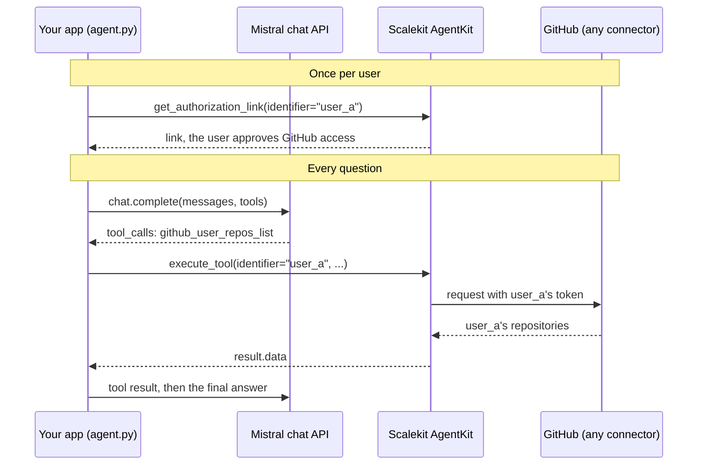

# Call any connector's tools as each user from a Mistral agent with Scalekit

Author: Saif ([@saif-at-scalekit](https://github.com/saif-at-scalekit)), Scalekit.

A Mistral function-calling agent usually runs every tool with one API token. Once a second person uses the same agent, that token reads the first person's data. In this guide, Mistral chooses the tool and [Scalekit AgentKit](https://docs.scalekit.com/agentkit/quickstart/) runs it with the access of the user who asked, through whichever connector the tool belongs to. Two users ask the same question and get two different answers.

GitHub is the example connector here: one Python script, one connection, and one read-only tool (`github_user_repos_list`). The per-user flow and the agent loop stay the same for any connector. To use another app, change `CONNECTION_NAME`, `TOOL_NAMES`, the question, and the strings that name GitHub.

Mistral's [function calling](https://docs.mistral.ai/capabilities/function_calling/) lets your app run each tool call, so your app decides whose account the call runs against.

## Your app picks the user, Mistral picks the tool, Scalekit runs it

Each user connects their account in the connected app once. After that, every question runs in four steps.



- **Scalekit** runs the OAuth flow, stores each user's tokens and refreshes them, and calls the connected app's API (GitHub here).
- **Your app** owns the agent loop and the `identifier`, your own stable ID for each user.
- **Mistral** chooses the tool and its arguments. It never sees a token.

## Setup needs a Mistral key, a Scalekit connection, and two test accounts

You need:

- Python 3.10 or later.
- A [Mistral API key](https://console.mistral.ai/) for a model that supports tool calling. The script uses `mistral-small-latest`; set `MISTRAL_MODEL` to use another.
- A [Scalekit account](https://app.scalekit.com). In **AgentKit > Connections**, create a connection for your app. This example uses a GitHub connection named `github`. Scalekit provides GitHub OAuth credentials, so you don't register a GitHub OAuth app for this example. See [Configure connections](https://docs.scalekit.com/agentkit/connections/).
- Two accounts in the connected app, one for each test user. This example uses two GitHub accounts.

Install the pinned packages:

```bash
pip install "mistralai==3.8.0" "scalekit-sdk-python==2.25.0" "python-dotenv==1.2.4"
```

Create a `.env` file. Find the Scalekit values in **app.scalekit.com > Developers > API Credentials**. Keep `.env` out of version control.

```bash
MISTRAL_API_KEY=...
SCALEKIT_ENVIRONMENT_URL=https://your-env.scalekit.cloud
SCALEKIT_CLIENT_ID=...
SCALEKIT_CLIENT_SECRET=...
```

Save the code from steps 1 to 5, in order, as `agent.py`.

## 1. One Scalekit client and one Mistral client serve every user

The `mistralai` 3.8.0 client imports from `mistralai.client`. `CONNECTION_NAME` picks the connector, and `TOOL_NAMES` limits the agent to one read-only tool.

```python
import json
import os

from dotenv import load_dotenv
from google.protobuf.json_format import MessageToDict
from mistralai.client import Mistral
from scalekit import ScalekitClient

load_dotenv()

scalekit_client = ScalekitClient(
    env_url=os.environ["SCALEKIT_ENVIRONMENT_URL"],
    client_id=os.environ["SCALEKIT_CLIENT_ID"],
    client_secret=os.environ["SCALEKIT_CLIENT_SECRET"],
)
actions = scalekit_client.actions
mistral = Mistral(api_key=os.environ["MISTRAL_API_KEY"])

MODEL = os.getenv("MISTRAL_MODEL", "mistral-small-latest")
CONNECTION_NAME = "github"  # the connection name you created in AgentKit
TOOL_NAMES = ["github_user_repos_list"]
MAX_TURNS = 5
```

## 2. Each user connects their account once per connector

A connected account links one `identifier` to one login in the connected app. `get_or_create_connected_account` returns the account and its status. Tools run only when the status is `ACTIVE`. Any other status, such as `PENDING_AUTH` for a new user or `EXPIRED` for a revoked token, gets a new authorization link from `get_authorization_link`.

```python
def connect(identifier: str) -> None:
    """Make sure this user's GitHub account is ACTIVE before the agent calls a tool."""
    account = actions.get_or_create_connected_account(
        connection_name=CONNECTION_NAME, identifier=identifier
    ).connected_account
    if account.status != "ACTIVE":
        link = actions.get_authorization_link(
            connection_name=CONNECTION_NAME, identifier=identifier
        ).link
        print(f"Authorize GitHub for {identifier}: {link}")
        input("Press Enter after you approve access...")
        account = actions.get_or_create_connected_account(
            connection_name=CONNECTION_NAME, identifier=identifier
        ).connected_account
    if account.status != "ACTIVE":
        raise RuntimeError(f"GitHub for {identifier} is {account.status}, not ACTIVE.")
```

**Open each user's link in a browser signed in to that user's account in the connected app.** If you approve `user_b`'s link in a window still signed in as the first account, both identifiers connect to the same login. Use a private window for the second user.

See [Connected account statuses](https://docs.scalekit.com/agentkit/concepts/) and [Authorize a user](https://docs.scalekit.com/agentkit/tools/authorize/).

## 3. Mistral sees only the tools this user can run

`actions.tools.list_scoped_tools` returns the tools one identifier can run, filtered here to one connection and one tool name. Scalekit stores each tool's JSON schema as `input_schema`; Mistral expects it as `parameters`, inside a `function` object.

```python
def mistral_tools(identifier: str) -> list[dict]:
    """List the tools this user can run and convert them to Mistral's tool format."""
    scoped, _ = actions.tools.list_scoped_tools(
        identifier=identifier,
        filter={"connection_names": [CONNECTION_NAME], "tool_names": TOOL_NAMES},
        page_size=100,
    )
    tools = []
    for scoped_tool in scoped.tools:
        definition = MessageToDict(scoped_tool.tool).get("definition", {})
        tools.append({
            "type": "function",
            "function": {
                "name": definition["name"],
                "description": definition.get("description", ""),
                "parameters": definition.get("input_schema", {"type": "object", "properties": {}}),
            },
        })
    return tools
```

Connectors can expose many tools; the GitHub connector has more than 200. Without the `tool_names` filter, one page of up to 100 tools reaches the model, and it can include tools that write. Name the tools the agent needs, and follow `next_page_token` if you list more than one page.

## 4. Every tool call runs as the user who asked

The tool-calling loop sends the question and the tools to Mistral. When Mistral returns `tool_calls`, the app runs each call with `execute_tool` and the same `identifier`, then sends the result back as a `tool` message. The loop ends when Mistral answers without a tool call.

```python
def ask(identifier: str, question: str) -> str:
    """Answer one question for one user. Every tool call runs as that user."""
    tools = mistral_tools(identifier)
    messages = [
        {"role": "system", "content": "Answer from the user's GitHub data. Call a tool instead of guessing."},
        {"role": "user", "content": question},
    ]
    for _ in range(MAX_TURNS):
        response = mistral.chat.complete(model=MODEL, messages=messages, tools=tools)
        message = response.choices[0].message
        if not message.tool_calls:
            return message.content
        messages.append(message)
        for call in message.tool_calls:
            arguments = call.function.arguments
            if isinstance(arguments, str):
                arguments = json.loads(arguments or "{}")
            result = actions.execute_tool(
                tool_name=call.function.name,
                tool_input=arguments,
                identifier=identifier,
                connection_name=CONNECTION_NAME,
            )
            messages.append({
                "role": "tool",
                "name": call.function.name,
                "tool_call_id": call.id,
                "content": json.dumps(result.data),
            })
    raise RuntimeError(f"No answer after {MAX_TURNS} model calls.")
```

`result.data` is the connected app's response as JSON. Mistral reads it in the next call and writes the answer.

## 5. Two users ask the same question and get different answers

User IDs `user_a` and `user_b` stand in for your app's own user IDs. Use a stable internal ID, not an email address, because an email can change or be reassigned.

```python
if __name__ == "__main__":
    users = ["user_a", "user_b"]  # your app's own user IDs
    question = "List the names of my five most recently pushed GitHub repositories."
    for identifier in users:
        connect(identifier)
    for identifier in users:
        print(f"\n{identifier}:\n{ask(identifier, question)}")
```

Run it:

```bash
python agent.py
```

- On the first run, the script prints an authorization link for each user. Approve `user_a` as the first GitHub account and `user_b` as the second.
- Each user gets a list of repository names. `user_a`'s list should contain only repositories the first GitHub account can see, and `user_b`'s only those of the second.
- Run the script again. It skips the links because both accounts are `ACTIVE`.

If both users get the same list, check two things. First, that `execute_tool` receives the identifier of the user who asked, not a fixed value. Second, that you approved each link while signed in to a different GitHub account.

## Expired accounts get a new link without affecting other users

A user can revoke access in the connected app, or a token can fail to refresh. The account then reports `EXPIRED`, and `connect` prints a new link for that user only. The other user's account stays `ACTIVE`. In a web app, show the link in your UI instead of calling `input`.

## Function calling keeps the user mapping in your app

Mistral [connectors](https://docs.mistral.ai/agents/tools/mcp) register an MCP server and connect it with credentials or an OAuth flow that Mistral runs. The [connector API](https://docs.mistral.ai/studio/connectors/management) doesn't accept OAuth tokens your app already holds.

Function calling lets your app keep the user mapping and run each call. Scalekit AgentKit offers the same per-user flow for more than 1,000 [connectors](https://docs.scalekit.com/agentkit/connectors/), with OAuth 2.0 and 2.1, API keys, bearer tokens and basic auth.

## Production needs user verification, your own OAuth app, and a short tool list

- **User verification.** New Scalekit environments activate an account for whoever completes the OAuth flow. Switch to a custom user verifier so your app confirms the person who approved is the user you meant. See [Verify users](https://docs.scalekit.com/agentkit/user-verification/).
- **Your own OAuth app.** When Scalekit provides the OAuth credentials, as it does for GitHub here, the consent screen shows Scalekit. Add your own OAuth app to the connection to show your app's name. See the [GitHub connector](https://docs.scalekit.com/agentkit/connectors/github/).
- **Tool choice.** Keep the tool list to what the agent needs. Add write tools only with a confirmation step in your app.

## Three common errors and their fixes

- `ImportError: cannot import name 'Mistral' from 'mistralai'`: you have `mistralai` 3 with a version 2 import. Use `from mistralai.client import Mistral`.
- The status stays `PENDING_AUTH` after you press Enter: the browser flow didn't finish. Open the link again and approve access.
- Mistral answers without calling the tool: check that `mistral_tools` returned one tool. An empty list means the connection name or tool name doesn't match AgentKit, or the user's account isn't connected.

## Next: switch connectors or manage connected accounts

- [GitHub connector](https://docs.scalekit.com/agentkit/connectors/github/): every GitHub tool, with its inputs.
- [Connector catalog](https://docs.scalekit.com/agentkit/connectors/): swap `CONNECTION_NAME` and `TOOL_NAMES` to use another app.
- [Manage connected accounts](https://docs.scalekit.com/agentkit/connected-accounts/): check status and ask users to reconnect.
